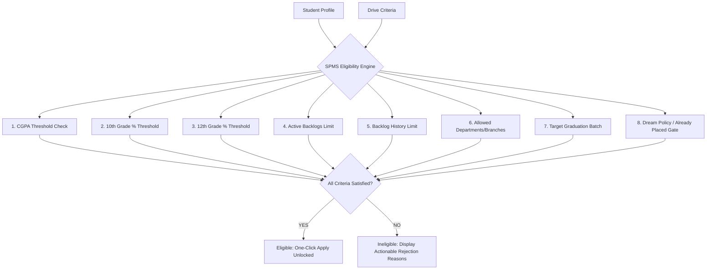
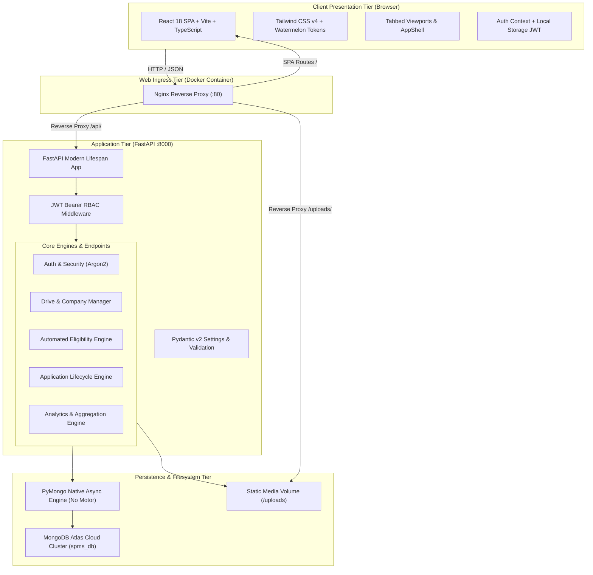
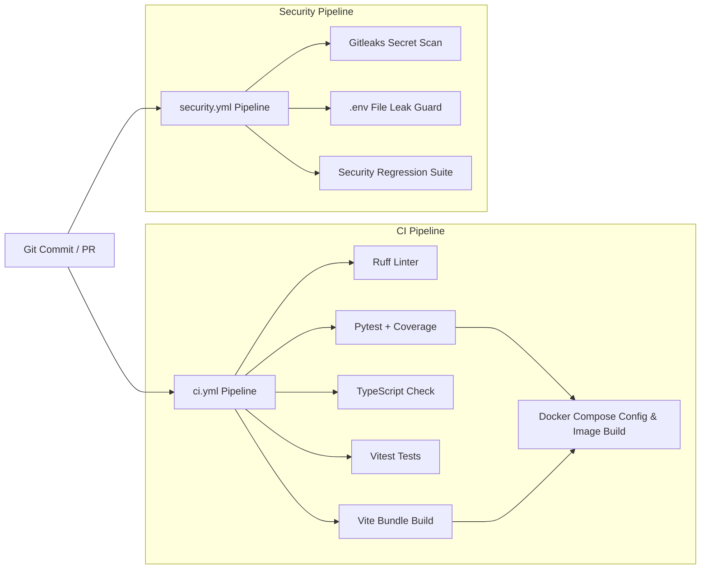

# Student Placement Management System (SPMS)

[](https://fastapi.tiangolo.com)
[](https://www.python.org/)
[](https://react.dev/)
[](https://www.typescriptlang.org/)
[](https://vitejs.dev/)
[](https://tailwindcss.com/)
[](https://www.mongodb.com/atlas)
[](https://www.docker.com/)
[](#-academic-context--syllabus-mapping)
[](.github/workflows/ci.yml)
[](.github/workflows/security.yml)

A state-of-the-art, role-based web platform designed to automate and centralize the end-to-end college placement and recruitment lifecycle at **KIET Group of Institutions, Ghaziabad**. 

Developed as a year-long B.Tech Computer Science Software Engineering Laboratory Capstone Project demonstrating the complete **Software Development Life Cycle (SDLC)** — encompassing rigorous requirements elicitation, architectural modeling, modular full-stack engineering, automated testing, quality assurance metrics, and DevSecOps container orchestration.

---

## 📑 Table of Contents

- [🎯 System Overview & Value Proposition](#-system-overview--value-proposition)
- [✨ Key System Features](#-key-system-features)
- [👥 User Roles & Dedicated Portals](#-user-roles--dedicated-portals)
- [⚙️ Automated Eligibility Engine](#️-automated-eligibility-engine)
- [🏛️ System Architecture](#️-system-architecture)
- [💻 Technology Stack](#-technology-stack)
- [📁 Repository Directory Structure](#-repository-directory-structure)
- [🔌 Complete REST API Reference](#-complete-rest-api-reference)
- [🗄️ Database Schema & Data Models](#️-database-schema--data-models)
- [🚀 Quick Start & Installation Guide](#-quick-start--installation-guide)
  - [Prerequisites](#prerequisites)
  - [1. Backend Setup](#1-backend-setup)
  - [2. Frontend Setup](#2-frontend-setup)
  - [3. Docker Containerized Setup](#3-docker-containerized-setup)
- [🔐 Environment Configuration (.env)](#-environment-configuration-env)
- [🎭 Demo Personas & Evaluator Credentials](#-demo-personas--evaluator-credentials)
- [🧪 Testing & Quality Assurance](#-testing--quality-assurance)
- [🛡️ Security Architecture & Hardening](#️-security-architecture--hardening)
- [🔄 CI/CD & DevOps Pipeline](#-cicd--devops-pipeline)
- [📚 Academic Context & Syllabus Mapping](#-academic-context--syllabus-mapping)
- [🗺️ Project Roadmap & Maintenance Backlog](#️-project-roadmap--maintenance-backlog)
- [📄 License & Authors](#-license--authors)

---

## 🎯 System Overview & Value Proposition

In institutional environments like KIET Group of Institutions, managing on-campus placement drives across **9 engineering departments** (~1,500+ graduating students annually) has traditionally relied on fragmented spreadsheets, ad-hoc Google Forms, unindexed resume drives, and noisy WhatsApp/email distribution lists.

### The Critical Deficiencies Addressed:
1. **Spreadsheet Chaos & Data Duplication**: Inconsistent records, conflicting student profiles, manual CGPA rounding errors, and out-of-date backlogs.
2. **Eligibility Verification Bottlenecks**: TPOs wasting dozens of hours manually filtering candidate sheets per company criteria (CGPA cutoffs, 10th/12th percentages, active vs. history backlogs, allowed branches).
3. **Application Blind Spots**: Students having zero visibility into application statuses, round shortlisting, or the exact rationale behind ineligibility.
4. **Recruitment Round Latency**: Recruiter feedback getting stalled in email threads rather than moving students immediately into consecutive evaluation stages.
5. **Lack of Executive Metrics**: Placement statistics (average CTC, highest package, branch-wise placement percentages) taking days to compile for accreditation (NBA, NAAC, NIRF).

**SPMS eliminates these friction points** by providing an event-driven, single-source-of-truth platform that unifies students, placement officers, corporate recruiters, and system administrators into synchronized workflows.

---

## ✨ Key System Features

- **⚡ Automated Academic Eligibility Engine**: Real-time evaluation against 8 distinct parametric criteria with transparent, instant feedback on exact rejection reasons.
- **🏢 Corporate Partner Directory**: Comprehensive management of recruiting partners with categorization by industry tiers (*Tier 1 Dream >10 LPA*, *Tier 2 Super Core*, *Tier 3 Core*, *Tier 4 Mass*), HR contact dossiers, and active drive history.
- **📋 Placement Drive Lifecycle Management**: Multi-step wizard creating campus drives with dynamic branch multi-select, custom recruitment round pipelines, stipend/CTC packages, and automatic application deadlines.
- **🔄 Dynamic Recruitment Pipeline Tracking**: Real-time stage advancement (`Applied` ➔ `Shortlisted` ➔ `OA Passed` ➔ `Tech Round 1` ➔ `Tech Round 2` ➔ `HR Round` ➔ `Selected` / `Rejected`).
- **📊 Real-time Analytics & Executive Dashboards**: High-performance MongoDB aggregation pipelines delivering placement rate percentages, CTC distributions, branch-wise placements, and drive performance analytics.
- **📄 Profile & Resume Vault**: Centralized student profile editor supporting multipart PDF resume uploads, skill tag management, and verified academic credentials.
- **⚡ 1-Click Instant Evaluator Sign-In**: Dedicated persona switchers for evaluators and viva examiners to test Student, TPO, Recruiter, and Admin dashboards instantly with zero typing.

---

## 👥 User Roles & Dedicated Portals

SPMS implements role-based access control (RBAC) with 4 primary personas, each accessing a purpose-built workspace:

| Persona | Role Identifier | Core Responsibilities & Portal Modules |
| :--- | :--- | :--- |
| **Student** | `STUDENT` | • **Dashboard Overview**: KPI cards (Placement Status, Active Applications, Drive Invites, Offers).<br>• **Placement Drives**: Filter active/upcoming drives; live 1-click eligibility check with diagnostic reason breakdown; 1-click apply.<br>• **My Applications**: Visual multi-round stage timeline tracking application progress.<br>• **Academic Profile**: Manage skills, CGPA, semester, backlogs, and upload PDF resumes. |
| **Placement Officer (TPO)** | `PLACEMENT_OFFICER`<br>*(aliases: `TPO`, `OFFICER`)* | • **Executive Overview**: High-level KPIs (Total Registered, Drives Active, Offers Released, Average Package).<br>• **Drive Manager**: Multi-step wizard to configure job descriptions, criteria, rounds, and eligibility gates.<br>• **Corporate Partners**: Add, edit, and organize tier-based company directories.<br>• **Candidate Pipeline**: Filter applicants per drive, review full candidate dossiers, and advance applicant stages.<br>• **Placement Analytics**: Interactive charts and distributions for college leadership. |
| **Corporate Recruiter** | `RECRUITER`<br>*(aliases: `COMPANY`, `HR`)* | • **Recruiter Dashboard**: Overview of company's active drives and applicant volume.<br>• **Job Drives**: Manage specific drives initiated by the partner corporation.<br>• **Applicant Review**: Review student profiles, inspect uploaded resumes, mark round qualifications, and publish final offers. |
| **System Administrator** | `ADMIN`<br>*(aliases: `SUPERADMIN`)* | • **System Telemetry**: Database connection health, memory/disk metrics, active sessions.<br>• **User Management**: Role assignments, password resets, account activation/suspension.<br>• **Audit Logs**: Immutable activity trails for critical placement operations.<br>• **System Configuration**: Global platform settings and department registries. |

---

## ⚙️ Automated Eligibility Engine

At the heart of SPMS is a deterministic, real-time eligibility verification engine (`backend/app/services/eligibility_service.py`). When a student navigates to or applies for a placement drive, the engine executes an atomic 8-point parameter verification:



### Evaluated Criteria Parameters:
1. **CGPA Threshold**: Validates current cumulative grade against `min_cgpa`.
2. **10th Standard Percentage**: Validates secondary school benchmark against `min_tenth_percentage`.
3. **12th Standard Percentage**: Validates senior secondary benchmark against `min_twelfth_percentage`.
4. **Active Backlogs**: Verifies student has $\le$ `max_active_backlogs` (typically 0 for Tier 1 companies).
5. **Backlog History**: Evaluates historical standing backlogs against `max_history_backlogs`.
6. **Department / Branch Gate**: Verifies department membership against allowed branches (`CSE`, `CSE(AIML)`, `CSE(AI)`, `CSIT`, `IT`, `CS`, `ECE`, `EEE`, `ME`).
7. **Graduation Batch**: Verifies passing year matches `allowed_batches` (e.g., `2025`).
8. **Dream Placement Policy**: Prevents students who have already accepted a placement offer from applying unless the company is flagged with `allow_already_placed = True`.

---

## 🏛️ System Architecture

SPMS is engineered as a **Modular Monolith** optimized for enterprise stability, rapid local iteration, and secure deployment:



---

## 💻 Technology Stack

### Frontend Architecture
- **Framework**: [React 18.3](https://react.dev/) + [TypeScript 5.6](https://www.typescriptlang.org/)
- **Bundler & Tooling**: [Vite 6.0](https://vitejs.dev/) with hot module replacement (HMR)
- **Styling & Design System**: [Tailwind CSS v4](https://tailwindcss.com/) with native `@tailwindcss/vite` plugin
- **Form Management & Validation**: [React Hook Form](https://react-hook-form.com/) + [Zod 4.6](https://zod.dev/) schema resolvers
- **Iconography**: [Lucide React](https://lucide.dev/) (modern vector icons)
- **Component Primitives**: Watermelon UI inspired design tokens (`Badge`, `Button`, `Card`, `Modal`, `EmptyState`, `Skeleton`, `Toast`)
- **Unit Testing**: [Vitest 5.0](https://vitest.dev/) + [@testing-library/react](https://testing-library.com/) + `jsdom`

### Backend Architecture
- **Web Framework**: [FastAPI 0.110+](https://fastapi.tiangolo.com/) with asynchronous ASGI handling
- **Application Server**: [Uvicorn 0.28+](https://www.uvicorn.org/) with modern lifespan event management
- **Data Validation & Settings**: [Pydantic v2](https://docs.pydantic.dev/) and `pydantic-settings` with strict startup validation
- **Database Driver**: Native [PyMongo Async API 4.9+](https://pymongo.readthedocs.io/) (`pymongo.AsyncMongoClient` with Server API versioning, fully deprecating legacy Motor)
- **Password Hashing**: [Argon2](https://en.wikipedia.org/wiki/Argon2) via `argon2-cffi`
- **Security & Authorization**: [PyJWT](https://pyjwt.readthedocs.io/) for HMAC-SHA256 bearer tokens
- **Code Quality & Testing**: [Ruff](https://astral.sh/ruff) (ultra-fast linter) + [Pytest 8.0+](https://docs.pytest.org/) + `pytest-asyncio` + `pytest-cov`

### Infrastructure & DevSecOps
- **Cloud Database**: [MongoDB Atlas](https://www.mongodb.com/atlas) (M0 cluster with TLS encryption)
- **Containerization**: [Docker](https://www.docker.com/) with multi-stage non-root containers
- **Service Orchestration**: [Docker Compose](https://docs.docker.com/compose/)
- **Web Server / Reverse Proxy**: [Nginx Alpine](https://nginx.org/) with Gzip compression and SPA rewrite rules
- **Continuous Integration**: [GitHub Actions](https://github.com/features/actions) (`ci.yml`, `security.yml`)
- **Security Auditing**: [Gitleaks v8](https://github.com/gitleaks/gitleaks) secret scanner

---

## 📁 Repository Directory Structure

```text
placement_project/
├── .github/
│   └── workflows/
│       ├── ci.yml                     # Full-stack CI (Ruff, Pytest, Vitest, Docker build)
│       └── security.yml               # Gitleaks secret scanning & .env leak detection
├── backend/
│   ├── app/
│   │   ├── api/
│   │   │   └── v1/
│   │   │       ├── endpoints/
│   │   │       │   ├── analytics.py   # TPO & Student aggregation metrics
│   │   │       │   ├── applications.py# Apply, status transitions, drive applicants
│   │   │       │   ├── auth.py        # Login, registration, token issuance, /me
│   │   │       │   ├── companies.py   # Corporate partner CRUD
│   │   │       │   ├── drives.py      # Placement drive lifecycle & criteria
│   │   │       │   └── students.py    # Profile management & resume uploads
│   │   │       └── api.py             # Top-level API router v1 aggregator
│   │   ├── core/
│   │   │   ├── config.py              # Pydantic Settings with startup validation
│   │   │   ├── database.py            # PyMongo native Async client & lifecycle
│   │   │   ├── roles.py               # Canonical RBAC roles & normalization
│   │   │   ├── security.py            # Argon2 hashing & JWT encoding/decoding
│   │   │   └── seeder.py              # Idempotent development data seeder
│   │   ├── schemas/                   # Pydantic request/response models
│   │   │   ├── analytics.py
│   │   │   ├── application.py
│   │   │   ├── company.py
│   │   │   ├── drive.py
│   │   │   ├── student.py
│   │   │   └── user.py
│   │   ├── services/
│   │   │   └── eligibility_service.py # Deterministic 8-point eligibility checker
│   │   └── main.py                    # FastAPI entrypoint, CORS, uploads, healthcheck
│   ├── tests/
│   │   ├── integration/
│   │   │   └── test_api_endpoints.py  # End-to-end API integration tests
│   │   └── unit/
│   │       ├── test_atlas_db.py       # MongoDB Atlas connection & ping tests
│   │       ├── test_cors_security.py  # Cross-origin policy enforcement
│   │       ├── test_eligibility.py    # Core eligibility algorithm unit tests
│   │       ├── test_eligibility_extended.py # Edge-case criteria verification
│   │       ├── test_security.py       # Password hashing & JWT tests
│   │       └── test_security_auth.py  # Auth token validation & invalidation
│   ├── Dockerfile                     # Multi-stage Python 3.10 slim container
│   ├── pyproject.toml                 # Ruff & Pytest configuration
│   └── requirements.txt               # Backend Python dependencies
├── frontend/
│   ├── src/
│   │   ├── components/
│   │   │   ├── layout/
│   │   │   │   └── AppShell.tsx       # Enterprise navigation shell, breadcrumbs, sidebar
│   │   │   ├── modals/
│   │   │   │   ├── CandidateDetailsDrawer.tsx # Candidate evaluation drawer
│   │   │   │   ├── CompanyModal.tsx   # Add/Edit company modal
│   │   │   │   └── CreateDriveWizard.tsx      # Multi-step drive wizard
│   │   │   ├── portals/
│   │   │   │   ├── AdminPortal.tsx    # Administrator system telemetry & audit
│   │   │   │   ├── PlacementOfficerPortal.tsx # TPO drive, company & pipeline manager
│   │   │   │   ├── RecruiterPortal.tsx# Recruiter candidate review & stages
│   │   │   │   └── StudentPortal.tsx  # Student drives, eligibility & applications
│   │   │   ├── ui/                    # Watermelon UI primitive components
│   │   │   │   ├── Badge.tsx
│   │   │   │   ├── Button.tsx
│   │   │   │   ├── Card.tsx
│   │   │   │   ├── EmptyState.tsx
│   │   │   │   ├── Modal.tsx
│   │   │   │   ├── Skeleton.tsx
│   │   │   │   └── Toast.tsx
│   │   │   └── AuthView.tsx           # Authentication view + 1-Click Persona cards
│   │   ├── context/
│   │   │   └── AuthContext.tsx        # React authentication provider & state
│   │   ├── services/
│   │   │   └── api.ts                 # Typed fetch client with Bearer token injection
│   │   ├── types/
│   │   │   └── index.ts               # Shared TypeScript domain interfaces
│   │   ├── App.tsx                    # Top-level view router
│   │   ├── index.css                  # Tailwind CSS v4 directives & theme tokens
│   │   └── main.tsx                   # React DOM root mounting
│   ├── tests/
│   ├── Dockerfile                     # Multi-stage Node 22 build + Nginx runner
│   ├── nginx.conf                     # Production Nginx reverse proxy configuration
│   ├── package.json                   # Dependencies & npm scripts
│   ├── tsconfig.json                  # TypeScript compiler settings
│   └── vite.config.ts                 # Vite bundler & Vitest configuration
├── docs/                              # Formal Software Engineering Documentation
│   ├── 01-introduction/               # Unit 1: SE evolution, problem statement, ethics
│   ├── 02-requirements/               # Unit 2: SRS (IEEE format), user stories
│   ├── 03-design/                     # Unit 3: System architecture, UML diagrams
│   ├── 04-quality/                    # Unit 4: Quality metrics & assurance
│   ├── 05-testing/                    # Unit 5: Verification, validation & maintenance
│   └── 06-devops/                     # Security remediation, Atlas audits & CI/CD
├── docker-compose.yml                 # Orchestration for frontend & backend
├── PROJECT_PROGRESS.md                # Detailed phase-by-phase development tracker
├── CHANGELOG.md                       # Version changelog (Keep a Changelog format)
└── MAINTENANCE_BACKLOG.md             # Categorized maintenance backlog
```

---

## 🔌 Complete REST API Reference

All primary API endpoints are prefixed with `/api/v1` and return standard JSON payloads. Interactive Swagger UI is hosted at `http://localhost:8000/api/v1/docs`.

### 1. Health & Telemetry
| Method | Endpoint | Access | Description |
| :--- | :--- | :--- | :--- |
| `GET` | `/` or `/health` or `/api/health` | Public | Returns system status, project name, version, and database engine. |

### 2. Authentication (`/api/v1/auth`)
| Method | Endpoint | Access | Description |
| :--- | :--- | :--- | :--- |
| `POST` | `/api/v1/auth/register` | Public | Register new student or staff user and return JWT bearer token. |
| `POST` | `/api/v1/auth/login` | Public | Authenticate user credentials and return JWT bearer token. |
| `GET` | `/api/v1/auth/me` | Authenticated | Retrieve authenticated user claims and associated profile. |

### 3. Student Profile & Documents (`/api/v1/students`)
| Method | Endpoint | Access | Description |
| :--- | :--- | :--- | :--- |
| `GET` | `/api/v1/students/me` | Student | Get current student's full academic and placement profile. |
| `PUT` | `/api/v1/students/me` | Student | Update personal details, contact info, skills, and links. |
| `POST` | `/api/v1/students/me/resume` | Student | Upload resume (PDF multipart form upload). |
| `GET` | `/api/v1/students/` | TPO / Admin | Paginated list of all student profiles with department/status filters. |
| `GET` | `/api/v1/students/{student_id}` | Staff | Retrieve comprehensive details for a specific student. |

### 4. Corporate Partners (`/api/v1/companies`)
| Method | Endpoint | Access | Description |
| :--- | :--- | :--- | :--- |
| `GET` | `/api/v1/companies/` | Authenticated | List all active corporate recruitment partners. |
| `POST` | `/api/v1/companies/` | TPO / Admin | Add new corporate recruiting partner with tier classification. |
| `GET` | `/api/v1/companies/{company_id}`| Authenticated | Get detailed profile of a corporate partner. |
| `PUT` | `/api/v1/companies/{company_id}`| TPO / Admin | Update company tier, website, contacts, and description. |
| `DELETE`| `/api/v1/companies/{company_id}`| Admin | Remove or archive a company record. |

### 5. Placement Drives (`/api/v1/drives`)
| Method | Endpoint | Access | Description |
| :--- | :--- | :--- | :--- |
| `GET` | `/api/v1/drives/` | Authenticated | List placement drives with automatic candidate eligibility flag for students. |
| `POST` | `/api/v1/drives/` | TPO / Recruiter | Create placement drive with eligibility rules and interview stages. |
| `GET` | `/api/v1/drives/{drive_id}` | Authenticated | Get full drive specification, package details, and round outlines. |
| `PUT` | `/api/v1/drives/{drive_id}` | TPO / Recruiter | Edit drive deadlines, eligibility criteria, or interview rounds. |
| `DELETE`| `/api/v1/drives/{drive_id}` | TPO / Admin | Delete or deactivate a placement drive. |

### 6. Applications & Pipeline (`/api/v1/applications`)
| Method | Endpoint | Access | Description |
| :--- | :--- | :--- | :--- |
| `POST` | `/api/v1/applications/` | Student | Submit application for a drive (runs atomic eligibility validation). |
| `GET` | `/api/v1/applications/my` | Student | Retrieve student's application history and stage progression. |
| `GET` | `/api/v1/applications/drive/{drive_id}`| Staff / Recruiter| List all student applicants for a drive with full academic scores. |
| `PUT` | `/api/v1/applications/{application_id}/status`| Staff / Recruiter| Advance applicant stage or update final status (`selected`, `rejected`). |

### 7. Analytics & Institutional Telemetry (`/api/v1/analytics`)
| Method | Endpoint | Access | Description |
| :--- | :--- | :--- | :--- |
| `GET` | `/api/v1/analytics/tpo` | TPO / Admin | Real-time institutional KPIs: total drives, offers, average CTC, branch stats. |
| `GET` | `/api/v1/analytics/student` | Student | Personal telemetry: applied count, shortlists, interview invites, offers. |

---

## 🗄️ Database Schema & Data Models

SPMS uses MongoDB collections modeled via Pydantic schemas:

```text
┌─────────────────┐       ┌──────────────────────┐       ┌─────────────────┐
│     users       │1     1│       students       │1     *│  applications   │
├─────────────────┤◄─────►├──────────────────────┤◄─────►├─────────────────┤
│ _id (ObjectId)  │       │ _id (ObjectId)       │       │ _id (ObjectId)  │
│ email           │       │ user_id (FK -> users)│       │ drive_id (FK)   │
│ password_hash   │       │ roll_number          │       │ student_id (FK) │
│ full_name       │       │ department           │       │ current_round   │
│ role (Enum)     │       │ cgpa, 10th%, 12th%   │       │ status (Enum)   │
│ is_active       │       │ active_backlogs      │       │ round_history[] │
│ created_at      │       │ skills[]             │       │ applied_at      │
└─────────────────┘       │ resume_url           │       └────────┬────────┘
                          │ placement_status     │                │
                          └──────────────────────┘                │ *
                                                                  ▼ 1
┌─────────────────┐1     *┌──────────────────────┐       ┌─────────────────┐
│    companies    │◄─────►│        drives        │       │                 │
├─────────────────┤       ├──────────────────────┤       │  Real-Time      │
│ _id (ObjectId)  │       │ _id (ObjectId)       │       │  Eligibility    │
│ name            │       │ company_id (FK)      │       │  Evaluation     │
│ industry        │       │ job_role, CTC        │       │  Engine Gate    │
│ tier            │       │ eligibility_criteria │       │                 │
│ website         │       │ rounds[]             │       │                 │
│ contact_email   │       │ status (active/closed│       └─────────────────┘
└─────────────────┘       └──────────────────────┘
```

---

## 🚀 Quick Start & Installation Guide

### Prerequisites
- **Python**: Version `3.10` or higher
- **Node.js**: Version `20.x` or higher (Node 22 LTS recommended)
- **MongoDB**: Active [MongoDB Atlas](https://www.mongodb.com/atlas) cluster connection string OR local MongoDB instance
- **Docker & Docker Compose**: Optional for containerized deployment

---

### 1. Backend Setup

```bash
# 1. Clone repository
git clone https://github.com/ArmanSinghOP/spms.git
cd spms/backend

# 2. Create and activate a Python virtual environment
python -m venv .venv
# On Windows (PowerShell):
.\.venv\Scripts\Activate.ps1
# On macOS/Linux:
source .venv/bin/activate

# 3. Install dependencies
pip install --upgrade pip
pip install -r requirements.txt

# 4. Configure environment variables
cp .env.example .env
# Edit .env with your MongoDB Atlas connection string and generated SECRET_KEY:
# Generate secret key: python -c "import secrets; print(secrets.token_urlsafe(48))"

# 5. Start the FastAPI development server
uvicorn app.main:app --reload --host 0.0.0.0 --port 8000
```
> The backend server will initialize on `http://localhost:8000`.  
> API docs will be immediately accessible at `http://localhost:8000/api/v1/docs`.

---

### 2. Frontend Setup

```bash
# 1. Navigate to the frontend directory
cd ../frontend

# 2. Install Node dependencies
npm install

# 3. Launch Vite development server
npm run dev
```
> The frontend client will run on `http://localhost:5173`.  
> Vite automatically proxies API requests from `/api` and `/uploads` directly to `http://127.0.0.1:8000`.

---

### 3. Docker Containerized Setup

To build and run the entire production-grade stack (FastAPI Backend + Nginx SPA Frontend) with a single command:

```bash
# From the project root directory
# Ensure MONGODB_URL and SECRET_KEY are exported or configured in .env
docker compose up --build
```
> Access the unified application at `http://localhost:80`.  
> Backend health check is automatically polled via Docker's built-in health checker.

---

## 🔐 Environment Configuration (.env)

The backend uses **Pydantic Settings** to validate all required parameters at startup. Create `backend/.env`:

```ini
# Application Metadata
PROJECT_NAME="Student Placement Management System (SPMS)"
VERSION="1.0.0"
API_V1_STR="/api/v1"
ENVIRONMENT="development"

# MongoDB Database Configuration
# MongoDB Atlas Cloud Cluster Connection String:
MONGODB_URL="mongodb+srv://<db_username>:<db_password>@<cluster-url>/?retryWrites=true&w=majority"
DATABASE_NAME="spms_db"

# Security & Cryptographic Signing
# Secret key must be at least 32 characters long
SECRET_KEY="your-cryptographically-secure-random-token-here-minimum-32-chars"
ALGORITHM="HS256"
ACCESS_TOKEN_EXPIRE_MINUTES=1440

# Explicit Allowed CORS Origins (Wildcard '*' is strictly blocked)
BACKEND_CORS_ORIGINS="http://localhost:5173,http://127.0.0.1:5173"

# Development Demo Accounts Seeding (Disabled automatically in production)
ENABLE_DEMO_SEEDING="true"
DEMO_ADMIN_PASSWORD="ChangeMeInDev123!"
DEMO_STUDENT_PASSWORD="ChangeMeInDev123!"
DEMO_RECRUITER_PASSWORD="ChangeMeInDev123!"
```

---

## 🎭 Demo Personas & Evaluator Credentials

To facilitate rapid evaluation, academic viva assessment, and feature demonstration, SPMS includes **1-Click Instant Persona Sign-In** right on the login page, alongside traditional credential sign-in:

| Persona Name | Email | Password | Role | Academic / Profile Characteristics | Demonstration Purpose |
| :--- | :--- | :--- | :--- | :--- | :--- |
| **Dr. Rajesh Verma** | `tpo@kiet.edu` | `Admin@123` | Placement Officer | Head TPO, full management rights | Create drives, add companies, view institutional analytics, advance candidates |
| **Arjun Sharma** | `arjun.sharma@kiet.edu` | `Student@123` | Student | **CSE • 8.75 CGPA • 0 Backlogs • Unplaced** | **Eligible Student**: Shows 1-click apply, green eligibility indicators, and round progression |
| **Priya Verma** | `priya.verma@kiet.edu` | `Student@123` | Student | **ECE • 6.85 CGPA • 1 Backlog • Unplaced** | **Borderline Student**: Demonstrates automatic rejection breakdown (CGPA cutoff & backlog gate) |
| **Rohit Singh** | `rohit.singh@kiet.edu` | `Student@123` | Student | **IT • 9.20 CGPA • 0 Backlogs • Placed** | **Placed Student**: Demonstrates Dream Company policy enforcement (single offer restriction) |
| **Sneha Kapoor** | `recruiter.google@google.com` | `Recruiter@123` | Recruiter | Google University Talent Acquisition | Corporate portal: shortlist applicants, grade rounds, view candidate resumes |
| **Administrator** | `admin@kiet.edu` | `Admin@123` | Administrator | System Administrator | Telemetry monitor, audit activity logs, user management |

---

## 🧪 Testing & Quality Assurance

SPMS maintains strict testing regimens across backend and frontend layers:

```bash
# 1. Run Backend Unit & Integration Tests with Coverage
cd backend
pytest tests/unit/ tests/integration/ -v --cov=app --cov-report=term-missing

# 2. Run Backend Linter (Ruff)
ruff check app tests

# 3. Run Frontend Unit Tests (Vitest + RTL)
cd ../frontend
npm test

# 4. Verify TypeScript Types
npx tsc --noEmit

# 5. Build Production Frontend Bundle
npm run build
```

### Automated Backend Test Suite Breakdown:
- `test_atlas_db.py`: Validates live ping, TLS handshakes, and database CRUD operations.
- `test_cors_security.py`: Verifies rejection of unauthorized origins and strict avoidance of wildcard `*`.
- `test_eligibility.py`: Validates 8-parameter eligibility logic under various cutoff permutations.
- `test_eligibility_extended.py`: Tests edge cases (borderline CGPAs, Dream offer rules, branch filters).
- `test_security.py` & `test_security_auth.py`: Cryptographic hash strength, expired token handling, and unauthorized role rejections.
- `test_api_endpoints.py`: End-to-end integration tests on HTTP endpoints using FastAPI `TestClient`.

---

## 🛡️ Security Architecture & Hardening

SPMS underwent a comprehensive security audit and credential hardening review:

1. **Strict Startup Validation**: FastAPI refuses to boot if `MONGODB_URL` contains placeholder tokens (`<db_password>`) or if `SECRET_KEY` is under 32 characters or matches known weak defaults.
2. **Sanitized Diagnostics**: Database connection errors and logs automatically mask connection credentials via `sanitize_mongo_uri()`.
3. **CORS Hardening**: Wildcard origins (`*`) are disallowed by configuration validators; only explicitly whitelisted origins can make cross-site requests.
4. **Argon2 Password Hashing**: State-of-the-art password hashing using Argon2id, securing credentials against GPU-based brute-force attacks.
5. **Git History Sanitization**: Historical commits sanitized using `git-filter-repo`; verified zero secrets committed using Gitleaks v8.18.2.
6. **Continuous Secret Scanning**: Every pull request and push is checked by Gitleaks and a custom `.env` verification step in `.github/workflows/security.yml`.

---

## 🔄 CI/CD & DevOps Pipeline

Continuous Integration is orchestrated through two dedicated GitHub Actions workflows:



---

## 📚 Academic Context & Syllabus Mapping

This project serves as the capstone submission for the **B.Tech Computer Science & Engineering — Software Engineering Laboratory** at **KIET Group of Institutions**:

| Lab Unit | Topic & Objectives | SPMS Implementation & Artifacts |
| :--- | :--- | :--- |
| **Unit 1** | Introduction to Software Engineering & SDLC | [`docs/01-introduction/`](docs/01-introduction/) — Comprehensive background, software crisis analysis, feasibility study, software quality characteristics, SDLC mapping, Agile+Spiral justification, and ACM/IEEE ethics. |
| **Unit 2** | Requirements Engineering & SRS | IEEE 830-compliant Software Requirements Specification (SRS), functional & non-functional requirements, stakeholder questionnaires, and traceability matrices. |
| **Unit 3** | System Design & UML Modeling | Layered modular architecture, class diagrams, sequence diagrams for eligibility checks, activity diagrams for multi-stage hiring, and ER/document schemas. |
| **Unit 4** | Software Quality & Metrics | Code quality metrics via Ruff, cyclomatic complexity monitoring, unit test coverage percentages via `pytest-cov`, and QA validation standards. |
| **Unit 5** | Software Testing, Maintenance & CI/CD | Black-box and white-box test plans, automated Pytest and Vitest test suites, Docker containerization, GitHub Actions pipelines, and categorized maintenance backlog ([`MAINTENANCE_BACKLOG.md`](MAINTENANCE_BACKLOG.md)). |

---

## 🗺️ Project Roadmap & Maintenance Backlog

- [x] **Phase 0**: Environment & Project Discovery (Git, tools, dependencies).
- [x] **Phase 1**: Unit 1 Documentation (Background, SDLC, Process Models, Feasibility, Ethics).
- [x] **Phase 2**: Requirements Engineering (SRS, Use cases, User stories).
- [x] **Phase 3**: Architecture & System Design (Modular Monolith, Schema, UML).
- [x] **Phase 4**: Database Layer Migration (Motor deprecated; PyMongo native Async API integrated).
- [x] **Phase 5**: Backend Core Engines (FastAPI, Argon2, JWT RBAC, Eligibility, Analytics).
- [x] **Phase 6**: Frontend UI (Tailwind CSS v4, Watermelon UI tokens, 4 Portals, Drive Wizard).
- [x] **Phase 7**: DevOps & CI/CD (Docker Compose, Nginx reverse proxy, GitHub Actions).
- [x] **Phase 8**: Security Remediation (Gitleaks scan, Pydantic settings hardening, CORS guard).
- [ ] **Phase 9 (Upcoming)**: Automated Email & WhatsApp notification dispatches via SendGrid / Twilio.
- [ ] **Phase 10 (Upcoming)**: AI-powered resume skill extraction and job-match scoring.

---

## 📄 License & Authors

This project is developed for educational and academic assessment purposes at **KIET Group of Institutions**.

### Project Maintainers & Contributors:
- **Lead Developer**: B.Tech Computer Science & Engineering Student, KIET Group of Institutions
- **Academic Mentor / Department**: Department of Computer Science & Engineering, KIET Group of Institutions
- **Repository**: [https://github.com/ArmanSinghOP/spms](https://github.com/ArmanSinghOP/spms)

---
*Student Placement Management System (SPMS) — Empowering institutional placement operations through automated software engineering.*
